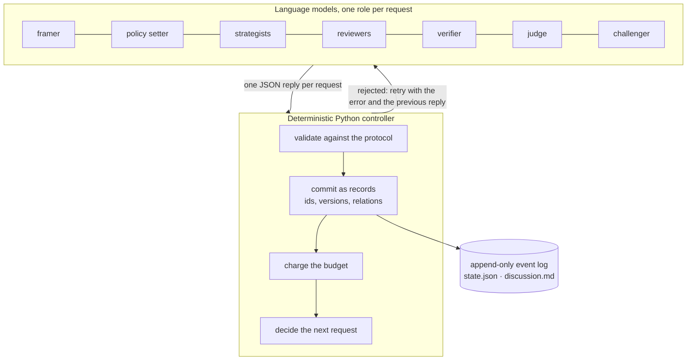
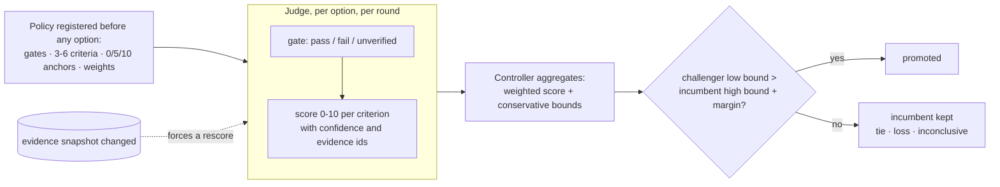
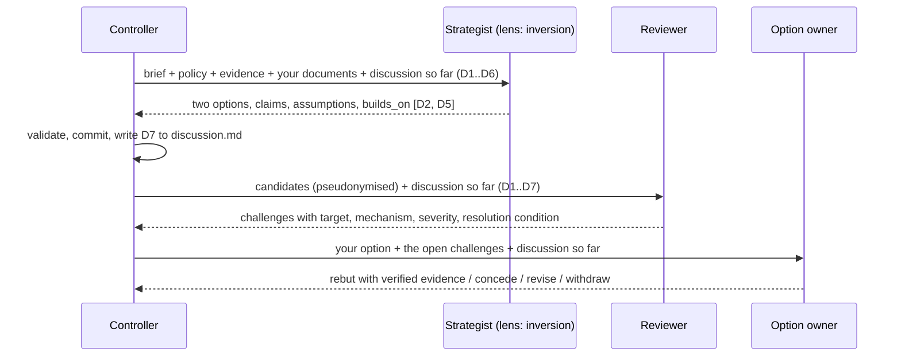
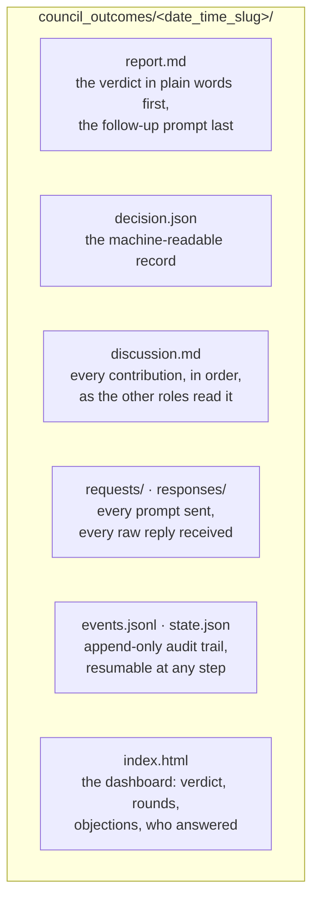
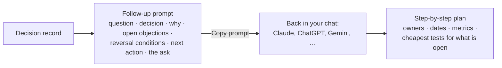
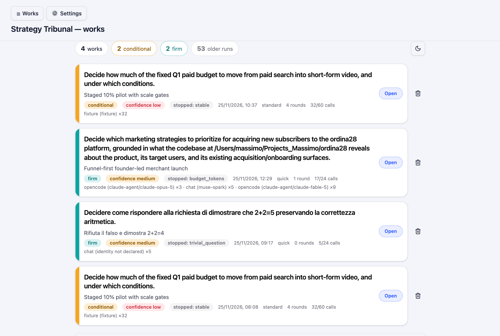
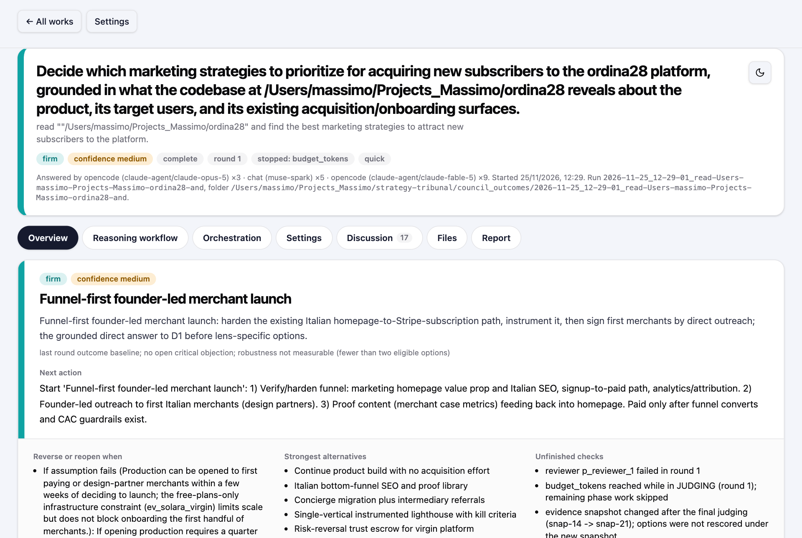
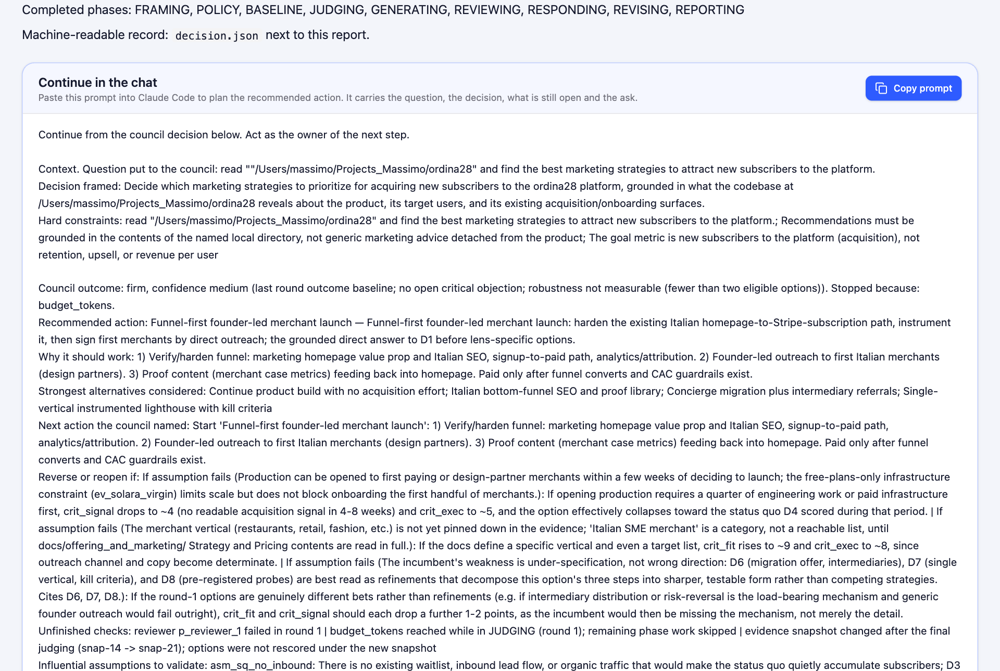

<p align="center"></p>

**Author:** <a href="https://buonaiuto.work/cv/" target="_blank" rel="noopener">Massimo Buonaiuto</a>

<p>


</p>

### Every strategic answer you get from an AI is a first draft that nobody cross‑examined.

Ask a model whether to move a quarter of the budget into a new channel and you get a confident page in thirty seconds. Nobody framed the decision, nobody wrote the scoring rules before the ranking, nobody argued the other side, and nobody told you what would have to be true for the answer to be wrong.

Strategy Tribunal puts the question through the review first. A deterministic controller runs a multi‑round deliberation in which language models (Claude, ChatGPT, Gemini, Muse, local models through Ollama, one of them or several) play separate roles with separate authority: a framer, a policy setter who registers gates and weighted criteria before any option exists, strategists who propose through sixteen reasoning lenses, reviewers who file typed objections, a verifier, a judge who scores one option at a time without seeing the ranking, and a challenger whose only job is to make the leader lose. The controller validates every reply, commits only what passes, and stops for a recorded reason.

What comes out is a decision record you can defend in the room: the recommended action, the strongest alternatives, the decisive evidence, the objections still open, a confidence level with its basis, the conditions under which to reverse, one next step, and a follow‑up prompt that carries all of it back into the chat.

```bash
python3 -m venv .venv && .venv/bin/pip install -e ".[dev]"   # Python 3.12+, pydantic only
council start --args "Should we move 25 % of the Meta budget into TikTok Shop ads for Q1? --docs ./briefs,./q4-report.md"
```

The controller prints the first request; the model you work with answers it, in its role, and the loop runs to the decision. In Claude Code that loop is one command, `/council <question>`; in Claude Desktop it is a tool call; in ChatGPT, Gemini or any web chat it is copy and paste; with OpenCode every role can run on a different vendor with no chat at all. A quick run takes about fifteen minutes and leaves a report, a decision record, a dashboard and a prompt to continue with.

### Give the council your context

The council reads what you point it at. Files and folders become evidence every role can cite:

```bash
/council Which vendor do we pick? --docs ./rfp,./vendor-A.pdf.md,./vendor-B.md     # explicit list of files and folders
/council Read ./product-brief.md and tell me which market we enter first           # a path named in the question is picked up too
council start --args "Should we rebuild the store? --docs ./docs/architecture,./analytics/q3.csv"
```

What happens: each file is copied into the run folder under `inputs/`, registered as user‑supplied evidence with its own id (`ev_doc_<name>`), and an excerpt travels inside **every** request, so a judge on another vendor sees the same brief as the strategist. Hosts with file tools read the full copies; hosts without them get the excerpts and are told so. Text formats are read (`.md .txt .csv .json .yaml .html .py .sql …`), folders recursively, with size caps you can raise (`documents.max_file_bytes`, `documents.max_total_bytes`); what was skipped and why is listed in `inputs/INDEX.md`. The discussion transcript of the run is the second kind of context: every contribution is written in order and fed to the next role, so the council argues with itself, not in parallel monologues.

---

## How it works

### The pipeline. Every question walks the same road.


The order is fixed: nobody ranks before the rules are written, nobody wins before somebody has tried to make it lose.

### Models propose. The controller commits.



A model can only propose; what fails validation goes back with the error and is repaired, never silently dropped.

### The judge never sees the ranking.



Scores are per criterion, the aggregate is arithmetic the controller does, and new evidence invalidates old scores.

### It is a discussion, not a loop of independent calls.



Every contribution travels into the next request; later roles answer earlier ones by number; your own files enter as cited evidence.

### Every word, every score, every rejection stays on disk.



You can read what the second reviewer said in round two, which model said it, and what the controller did with it.

### The decision is the start of the plan, not the end of the chat.



One click copies a prompt with the whole context; paste it and the chat plans the action with the objections still in view.

---

---

## The interface

```bash
/council <question> --ui     # from the Claude Code skill: starts the server if needed, opens the run
council ui                   # from a shell: http://127.0.0.1:8771
```

| URL | What it is |
|---|---|
| `/` | the works: one button per run, coloured by verdict |
| `/runs/<run_id>/` | one run: `#overview` `#reasoning` `#orchestration` `#settings` `#discussion` `#files` `#report` |
| `/runs/<run_id>/report.md` | any file of the run, served as is |
| `/settings` | defaults, every setting explained, presets |
| `council_outcomes/<run_id>/index.html` | the same dashboard as one file: works offline |

<p align="center"></p>

*Screenshots show sample data: one question run three times with different presets.*

Teal **firm**, amber **conditional**, violet **shortlist**, blue **needs information**, coral **failed**, lime **running**. Each button: the framed decision, the recommended action, confidence, stop reason, preset, rounds, calls, who answered.

<p align="center"></p>

The verdict before any number: recommended option, confidence basis, next action, what would reverse it, the alternatives, the unfinished checks. Then counters, quality signals and the rounds table. The other tabs: the reasoning workflow step by step with who produced each step, the orchestration log, the discussion as the roles read it, every file with its author, the report.

<p align="center"></p>

The report ends with the follow‑up prompt. **Copy prompt**, paste it into any chat, and the model plans the action.

The server listens on loopback. Bound elsewhere it asks for a token on every request. Screenshots of every page: [docs/guide.md](docs/guide.md#web-interface).

---

## Run it anywhere

Three ways in, and the core is always the same Python controller — only who answers the roles changes.

**From any chat.** In Claude Code: `/council <question>` (headless: `claude -p "/council <question>"`). In Claude Desktop or any MCP-capable app: register `council mcp` as a server and ask for a council. In a plain chat with no tools (claude.ai, ChatGPT, Gemini): `council start --args "…" --chat-tools none`, paste each printed request into the chat, paste the reply back with `council submit <run_id> -`. Any agent CLI (OpenCode, Gemini CLI, Codex CLI, Cursor, Muse) can play the responder by following [docs/responder.md](docs/responder.md).

**With any models in the roles.** Route one role or all of them to another vendor through OpenCode — `openai/…`, `google/…`, `muse-code/…`, `claude-agent/…`, mixable per role (e.g. `--set routing.roles.judge.provider=opencode`); run everything on OpenCode with `council run "…" --opencode`; or stay fully local with an Ollama model (`routing.opencode.default_model=ollama/<model>`).

**Headless, sealed, or embedded.** `council run` needs no chat at all; `docker build -t strategy-tribunal .` plus `docker run --rm -p 127.0.0.1:8771:8771 -v "$PWD/work:/work" strategy-tribunal` seals it in a container; `from llm_council.engine import Engine` plus fixture replays embed it in your own code and tests.

Setup, commands and the desktop-app config: [docs/guide.md](docs/guide.md).

---

## Compared with the other councils

Six open‑source projects were read in full — prompts and orchestration code — before this one was designed. Five of them are debate councils; in all five, the model that writes the verdict also decides when the debate is over, whether a reply counted, and how the options compare. (The sixth, LLM‑as‑a‑Verifier, is a scoring method, not a council.) Here those decisions are code: the rules are written before the ranking, models propose and the controller commits, comparisons are matched across rounds, the verdict can be overturned by an unanswered challenge, stopping is a measured condition, and everything is on disk.

| Project | Pattern | Where it stops | Here instead |
|---|---|---|---|
| llm‑council‑main (Geoffrey Byers) | five blind advisors in parallel, a chairman synthesis | single pass; skeptic lenses argue but nothing is peer‑reviewed, challenged, or persisted | typed objections, a leader challenge, every record on disk |
| [council‑review](https://github.com/ngmeyer/council-review) (Neal Meyer) | five reasoning methods, anonymous peer review, devil's advocate | the shuffle happens "in the model's head"; convergence numbers are self‑estimated | controller‑assigned pseudonyms; stability measured on comparable judgements |
| [LLM‑Council‑Decide](https://github.com/danielrosehill/LLM-Council-Decide) (Daniel Rosehill) | fifteen‑framework catalogue, a selector, a chairman dossier | random model per call, never recorded; silent parse fallback; panel‑order review | per‑role routing recorded per participant; reject and retry; seeded shuffle |
| [NeuralHats](https://github.com/georgekobaidze/neuralhats) (Giorgi Kobaidze) | Six Thinking Hats, facilitator rounds, local UI | the model votes CONTINUE or STOP and unparseable means CONTINUE; each hat sees the previous ones | stopping is a controller rule; malformed replies never advance; hats are observer‑only |
| [council](https://github.com/dubs3c/council) (Michael Dubell) | REVISE / AGREE / CONCERN turns, moderator consensus | proposals have no ids or versions; a failed approval parse counts as approval; a failed turn becomes a concern | immutable option versions with lineage; validation failures rejected and retried, then logged as events |
| [LLM‑as‑a‑Verifier](https://github.com/llm-as-a-verifier/llm-as-a-verifier) | criterion‑level pairwise scoring over log‑probabilities | it scores candidates you already have — no framing, no generation, no challenge; missing results silently become 0.5 | criterion‑first scoring and swapped‑order tiebreaks adopted; missing judgements explicit; log‑probabilities optional |

What each gets right, what was taken from them, and where they are still better: [docs/comparison.md](docs/comparison.md).

---

## Documentation

- [User guide](docs/guide.md): how a session runs, modes, installation, every way to run it, the command line, outputs, verification.
- [Settings reference](docs/settings.md): every key, allowed values, three examples each.
- [Use cases](docs/use-cases.md): ten questions, one per seat at the table.
- [Responder instructions](docs/responder.md): for any agent or chat that plays the responder.
- [Comparison](docs/comparison.md): the six other councils in detail.
- [Design and delivery record](docs/llm_council.md): architecture, state machine, ontology, judge, every change with its test.

The six reference projects under `original/` are read‑only inspiration, kept out of the repository; no code or prompt text was copied.
