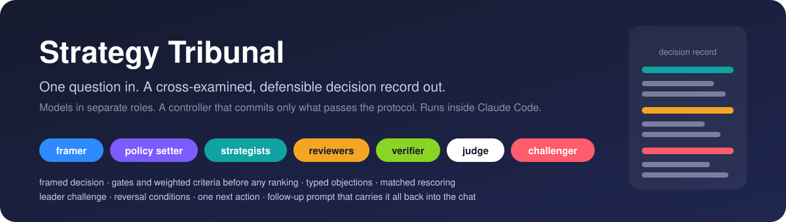
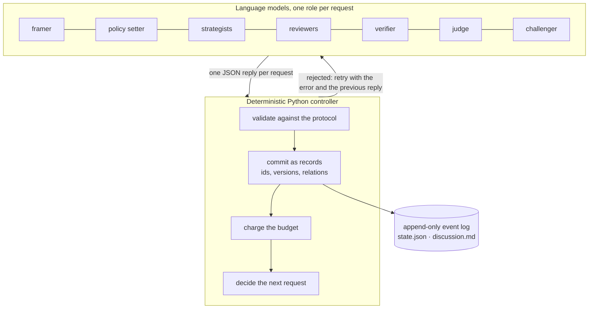
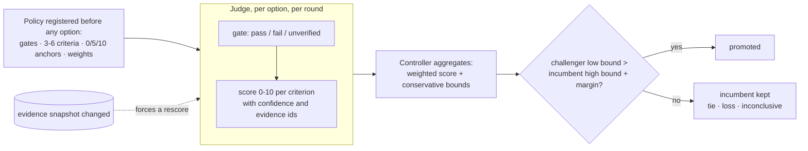
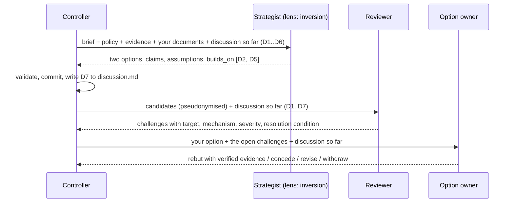
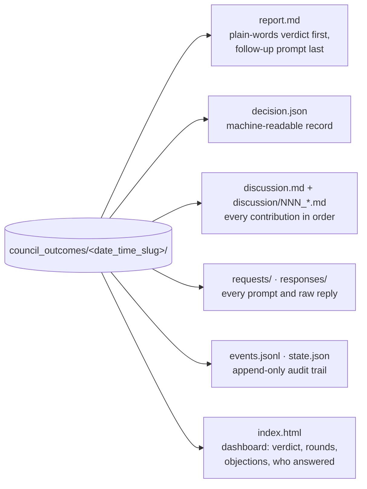
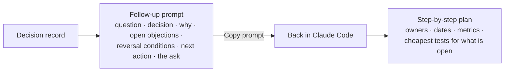

<p align="center"></p>

# Strategy Tribunal

**Author:** Massimo Buonaiuto

<p>


</p>

### Every strategic answer you get from an AI is a first draft that nobody cross‑examined.

Ask a model whether to move a quarter of the budget into a new channel and you get a confident page in thirty seconds. Nobody framed the decision, nobody wrote the scoring rules before the ranking, nobody argued the other side, and nobody told you what would have to be true for the answer to be wrong. You then take that page into a meeting as if it had been through a review.

Strategy Tribunal puts the question through the review first. A deterministic controller runs a multi‑round deliberation in which language models play separate roles with separate authority: a framer, a policy setter who registers gates and weighted criteria before any option exists, strategists who propose through sixteen reasoning lenses, reviewers who file typed objections, a verifier, a judge who scores one option at a time without seeing the ranking, and a challenger whose only job is to make the leader lose. The controller validates every reply against a protocol, commits only what passes, promotes a challenger only when its conservative lower bound clears the incumbent's upper bound, and stops for a recorded reason.

What comes out is a decision record you can defend in the room: the recommended action, the strongest alternatives, the decisive evidence, the objections still open, the trade‑offs accepted, a confidence level with its basis, the conditions under which to reverse, one concrete next step, and a follow‑up prompt that carries all of it back into the chat so the plan starts where the deliberation ended.

**Built for people who sign off on strategy.** Founders choosing a market, marketing leads reallocating budget, consultants who need a paper trail behind a recommendation, product teams deciding what to kill. Runs inside Claude Code as `/council <question>`; routes single roles to other models through OpenCode when you want a second opinion from a different vendor; reads your own documents and codebase as evidence.

**Why you can trust the output.** Models propose, the controller commits: every id, score and promotion is checked before it enters the record. The judge never computes its own aggregate. Review payloads hide authorship when roles run in isolated sessions. An evidence change forces a rescore. 130 deterministic tests cover the protocol, the state machine, the judge arithmetic and the prompt contract, without a single model call. Every run leaves an append‑only event log, the full discussion transcript, every request and raw reply, and a dashboard that shows who said what in which round.

```bash
pip install -e ".[dev]"        # Python 3.12+, pydantic only
claude                          # start Claude Code in this folder
/council Should we move 25 % of the Meta budget into TikTok Shop ads for Q1?
```

A quick run takes about fifteen minutes on the chat route and leaves you a report, a decision record, a dashboard, and a prompt to continue with. Read on for ten ways to use it, how a session runs, the modes, the settings and the CLI recipes.

---

## How it works

### The pipeline. Every question walks the same road.

```mermaid
flowchart LR
    Q([Your question]) --> F[FRAMING<br/>framer]
    F --> P[POLICY<br/>gates + weighted criteria]
    P --> B[BASELINE<br/>status quo + direct answer]
    B --> R
    subgraph R [one round, repeated until stable]
        direction LR
        G[GENERATING<br/>strategists, one lens each] --> RV[REVIEWING<br/>typed objections]
        RV --> V[VERIFYING] --> RS[RESPONDING<br/>owners answer]
        RS --> J[JUDGING<br/>one option at a time] --> RE[REVISING<br/>promote or keep]
    end
    R --> C[CHALLENGING<br/>make the leader lose]
    C --> D([Decision record<br/>+ follow-up prompt])
```



The order is fixed and the controller enforces it. Nobody ranks before the rules are written; nobody wins before somebody has tried to make it lose.

### Models propose. The controller commits.



A model can only propose. Every id it cites must exist, every score must cite evidence or a stated assumption, every challenge must name a legal target. What fails is sent back with the error and the previous reply, and only the error is repaired.

### The judge never sees the ranking.



Scores are attribute by attribute, never an overall impression. The aggregate is arithmetic the controller does; a promotion needs the challenger's lower bound to clear the incumbent's upper bound. New evidence invalidates old scores.

### It is a discussion, not a loop of independent calls.



Every contribution is written in order and travels into the next request. Later roles answer earlier ones by number. Your own files and folders enter as cited evidence.

### What lands in the run folder.



Nothing is summarised away. You can read what the reviewer said in round 2, which model said it, and what the controller did with it.

### The decision is the start of the plan, not the end of the chat.



The report ends with a prompt that carries the whole context. One click copies it; paste it and the same chat plans the recommended action with the objections still in view.

---

## A single prompt versus the tribunal

| | One prompt to one model | Strategy Tribunal |
|---|---|---|
| Who framed the decision | nobody | a framer, with user‑stated constraints kept verbatim and assumptions labelled |
| When the scoring rules were written | never | before any option exists, as gates and weighted criteria |
| Who argued the other side | nobody | reviewers with typed objections, then a challenger whose job is to make the leader lose |
| How options were compared | one impression | per criterion, one option at a time, aggregated by the controller, matched across rounds |
| What happens when evidence changes | nothing | affected options are rescored |
| What you can audit afterwards | the answer | every request, reply, rejection, score, promotion and stop reason |
| What tells you when to change your mind | nothing | reversal conditions and the objections still open |
| How you continue | start over | a follow‑up prompt that carries the decision and its caveats into the next step |

---

## 10 ways to use it

One question in, one defensible decision out. Each example below is a different seat at the table — copy the command, change the nouns, run it.

1. **Founder choosing a launch market**
   ```
   /council We can launch in Italy or Spain first with the same team. Which market do we enter in Q1? --preset quick --lenses outside_view,expected_value
   ```
   You get a ranked entry case with hard gates (language, regulation, reachable CAC) instead of a gut call, plus the dissent you will hear from your co‑founder anyway.

2. **Marketing lead reallocating budget**
   ```
   /council Should we move 30% of our Q1 paid-search budget into short-form video, or keep the mix? --preset quick
   ```
   Scored options against criteria you register up front (cost per acquisition, payback time, creative capacity), one next action, and the conditions that would reverse the call.

3. **Consultant who needs a paper trail**
   ```
   /council Which fulfilment vendor should the client pick for 2027: A at 120k EUR/year and 97% on-time, or B at 100k and 80%? --preset quick
   ```
   The decision record carries evidence ids, failed gates, open objections and a confidence basis — the appendix your recommendation slide was missing.

4. **Product team deciding what to kill**
   ```
   /council Should we sunset feature X in Q1 or keep maintaining it for the 8% of accounts that use it? --lenses regret,inversion
   ```
   Regret and pre‑mortem lenses force the kill criteria and the losing scenario into the open before the roadmap meeting.

5. **First marketing hire vs agency retainer**
   ```
   /council With 60k EUR for the year, do we hire a junior marketer or keep the agency on a 5k/month retainer? --preset quick
   ```
   Build‑vs‑buy scored on output per euro, ramp time and reversibility — and an explicit statement of what would change the answer if the hire outperforms.

6. **Pricing change**
   ```
   /council Should we raise plan prices 20% in January or hold and push volume? --preset standard --lenses second_order,expected_value
   ```
   Second‑order effects (churn, support load, positioning) are scored, not footnoted; the report says which evidence (win/loss calls, competitor moves) would settle it.

7. **Replatforming the stack**
   ```
   /council Should we migrate the store from Shopify to a custom build before the holiday peak? --docs docs/architecture --preset standard
   ```
   Your own architecture notes enter as cited evidence; the migration risk lands in the objections table with a resolution condition instead of in a Slack thread.

8. **Agency stress‑testing a pitch**
   ```
   /council Which creative direction do we pitch the client: humour-led or proof-led? --lenses balanced_ledger,execution --opencode
   ```
   An isolated challenger tries to kill the favourite before the client does; you walk in with the counter‑arguments already answered.

9. **Physical expansion: the second location**
   ```
   /council Do we open the second shop in the Navigli district now, or renew the current lease and wait a year? --preset quick
   ```
   Rent, foot traffic, cannibalisation and staffing become weighted criteria; the deposit deadline becomes a recorded stopping reason instead of panic.

10. **Nonprofit allocating a fixed grant**
    ```
    /council The board capped the grant at 50k EUR with no overspend possible. Which of these three programmes do we fund? --preset quick
    ```
    Anything over budget fails a hard gate visibly in the report — the board sees what was excluded and why, not just what won.

## How a session runs

You type a decision, topic or scope (for example *"Should we move 25 % of the Meta budget into TikTok Shop ads for Q1?"*). The engine then:

1. **Frames the decision** — objectives, stakeholders, hard constraints, time horizon, stakes, reversibility, evidence gaps, and the concrete decision a broad topic implies. User‑stated facts are kept verbatim; inferred assumptions are labelled.
2. **Registers an evaluation policy before ranking** — hard gates (pass / fail / unverified), 3–6 weighted score criteria with 0/5/10 anchors, priority scenarios, materiality threshold and promotion rule. A round‑zero baseline (status quo and the most direct answer) is scored first.
3. **Generates diverse strategies** through selectable reasoning *lenses* (first principles, inversion, staging, information option, asymmetric upside, outside view, execution, second order, expected value, time horizons, regret, tempo, internal/external, multidisciplinary, widen‑and‑reality‑test, balanced ledger, Six‑Hats observers). Duplicates are merged with lineage intact.
4. **Cross‑reviews and verifies** — typed challenges (target, failure mechanism, severity, class, what could change, resolution condition), compact rebuttals, optional verification calls, shared blind‑spot detection.
5. **Revises and adjudicates on matched inputs** — revisions, mergers, withdrawals and reinstatements are judged against the incumbent under the same brief, rubric, evidence snapshot and judge configuration. Promotion needs the challenger's conservative lower bound to clear the incumbent's upper bound; an evidence change forces a rescore; non‑comparable results are labelled, never imputed.
6. **Challenges the leader** — a dedicated sceptical pass must name the scenario in which the leader loses, the strongest alternative in that scenario and the evidence that would distinguish them. An unresolved challenge that could alter the outcome turns a firm recommendation into a conditional one.
7. **Stops for a recorded reason** — stability, no productive follow‑up, max rounds, call / token / time / cost budget, cancellation or failure — and **reports**: recommended action or reason to defer, strongest alternatives, decisive evidence, material dissent, trade‑offs, round‑by‑round change in decision quality, confidence with its basis, reversal conditions, one concrete next action, unfinished checks, and a machine‑readable decision record.

**Two workflows run in every council.** The **orchestration workflow** is the controller's state machine: it issues one validated request at a time to a role, checks the reply against the protocol, commits or rejects it, charges the budget, decides promotions and stops; it is deterministic Python and never reasons about the question. The **reasoning workflow** is what the models do in their roles: framing, gates and criteria, options through lenses, objections and answers, scores, the leader challenge, the decision. The dashboard and the report show both, step by step, with who produced each step (role, provider, model). Each role receives the records it needs as data (brief, policy, evidence snapshot, the options or challenge in question) **plus the discussion so far and the user's documents**; outputs of earlier phases reach later phases both as validated records and as the readable transcript.

**It is a discussion, not a loop of independent calls.** Every model contribution is written, in order, to `discussion/NNN_rR_<phase>_<role>.md` and `discussion.md` in the run folder, and every later request carries `discussion_so_far`: the full text of the current round's contributions plus the controller's digest of each earlier round (incumbent, outcome, ranking, open objections) and a short summary of every earlier contribution, within `discussion.max_chars`. Roles are instructed to build on, answer or contest what the others said and to list the D‑numbers they rely on in `builds_on`. On the chat route the model can also read the transcript files directly. Every request opens with a **context block** that explains the council, the role's place in it, who consumes the reply and whether the role has tools (see *What every model receives* below).

**Input documents.** `--docs path,folder` reads the user's files (text formats, size‑capped), copies them to `inputs/`, registers each as user‑supplied evidence (`ev_doc_<name>`) that every role can cite, and places capped excerpts in every request; on the chat route the full copies are readable. A local file or folder named in the question itself ("read /path/to/project and …") is registered the same way when no `--docs` is given.

Everything decision‑relevant (ids, versions, judgements, comparisons, events) is validated against a versioned protocol (`pydantic` v2) **before** state changes. Only the controller commits state; models only propose. Every run is persisted as an append‑only event log plus a snapshot, so it can be resumed, audited and re‑reported.

### Modes

| Mode | How | Context |
|---|---|---|
| **Default: one model in the current chat** | `/council …` inside Claude Code. The Python controller prints one validated request at a time; the chat model answers it in the named role (framer, policy setter, strategist, reviewer, verifier, judge, challenger); the controller validates, commits and advances. | Shared context (recorded as a limitation; no blind review is claimed) |
| **Opt‑in OpenCode route** | `--opencode` or `routing.opencode.enabled=true`; roles can be routed individually to other providers and models (Anthropic subscription, OpenAI, local Ollama, …) through a tools‑denied OpenCode agent. | Isolated: fresh session per call, pseudonymised review payloads, identity and measured tokens recorded |
| **Autonomous / headless** | `council run …` with a fixture (tests) or with all roles on OpenCode (benchmarks); or a headless Claude Code session `claude -p "/council …"`. | As above |

Every mode writes the run into its own folder under `council_outcomes/` and keeps a graphical dashboard (`index.html`) up to date; `council ui` serves all runs, KPIs and a settings editor on `127.0.0.1` (see **Web interface** below).

### Project layout

```
council/
├── .claude/skills/council/SKILL.md            chat entry point   /council …
├── .claude/skills/council-settings/SKILL.md   settings entry point   /council-settings …
├── council.config.json                        project defaults (configuration layer 2)
├── .council/settings.json                     saved settings (layer 3, written by `council settings …`)
├── council_outcomes/<YYYY-MM-DD_HH-MM-SS_question-slug>/   one folder per run: index.html (dashboard), TITLE.txt,
│                                              report.md, decision.json, state.json, events.jsonl, requests/, responses/
├── .council/runs/<run_id>/                    legacy run folders (still readable)
├── adapters/opencode/opencode.json            restricted OpenCode agent "council-member"
├── benchmarks/                                cases.json, run_campaign.py, results/
├── docs/                                      spec.md, llm_council.md (delivery record)
├── web/                                       the React interface (Vite + Tailwind 4 + Radix/shadcn-style components);
│                                              `npm run build` writes src/llm_council/static/dashboard.{js,css}
├── src/llm_council/                           ontology, config, settings, lenses, prompts, phases, judge, budget, discussion,
│                                              trail, state, engine, report, dashboard, ui, static/, providers/{fixture,opencode,driver}, cli
└── tests/                                     130 deterministic tests; fixtures built by tests/fixtures/build_fixtures.py
```

---

## Installation

Requirements: macOS or Linux, Python ≥ 3.12 with `pip` and `venv`, and for the chat mode [Claude Code](https://claude.com/claude-code). Optional: [OpenCode](https://opencode.ai) v2.x for the external route, with its own provider credentials (`opencode auth login`); the engine never reads, stores or logs credentials. Node.js is needed **only** to rebuild the web interface after editing `web/src` (`cd web && npm install && npm run build`); the built bundle ships in `src/llm_council/static/`, so using the interface needs no Node.

```bash
cd "/path/to/council"                     # this folder
python3 -m venv .venv                     # keep the venv at .venv: the Claude Code skills call .venv/bin/council
source .venv/bin/activate
pip install -e ".[dev]"                   # pydantic 2 + the `council` command (+ pytest)
council --version                         # council 0.1.0
python -m pytest                          # optional check: 130 passed, no model calls (use python -m: a Homebrew pytest may shadow the venv one)
```

Dependencies are declared in `pyproject.toml` (runtime: `pydantic>=2.7,<3`; dev: `pytest>=8`). Plain `pip` and `venv` are the only tools needed.

Start Claude Code **inside this folder**. The `/council` and `/council-settings` skills are discovered from `.claude/skills/` here and are not visible to a session started in a parent folder; they run `.venv/bin/council`, so the venv must exist at `.venv` in the project root.

Optional OpenCode route check:

```bash
opencode --version             # v2.x
opencode models                # providers/models OpenCode can reach
council config show --opencode
```

---

## How to use it

### From Claude Code (recommended)

```
/council <question or topic> [--preset quick|standard|deep|first_pass] [--docs path,folder] [--opencode] [--lenses a,b,c] [--set key=value] [--run-id id]
/council-settings [show | set key=value … | unset key | wizard | routes | presets | reset]
```

The skill writes your arguments verbatim to an args file, starts the run, answers each `=== COUNCIL REQUEST … ===` block as the named role, submits, and finally shows the controller's summary, the full `report.md` and the `decision.json` path. Typical cost on the chat route: `quick` ≈ 24 model calls / 15 min, `standard` ≈ 45 calls / 15–20 min, `first_pass` ≈ 15–21 calls.

### From the command line

```bash
# step mode (what the skill does for you)
council start "<question>" [--preset …] [--opencode] [--lenses …] [--set k=v] [--run-id id]
council submit <run_id> <response.json> --request-id req_xxxx [--chat-model id] [--effort label]
council start "<question>" --chat-model claude-sonnet-5-5   # record which conversation model answers chat-routed requests
council next <run_id> [--set k=v]            # re-print the pending request / resume after an interruption
council status <run_id>                      # phase, round, incumbent changes, open objections, budget
council report <run_id> | rereport <run_id> | cancel <run_id> | runs
council dashboard <run_id> [--open]               # regenerate (and open) the run's index.html
council ui [--port 8771] [--no-open]                # local web interface: all runs, KPIs, dashboards, settings editor
council start "<question>" --ui                     # start a run and open its dashboard in the web interface

# autonomous mode (fixture or OpenCode providers)
council run "<question>" --fixture tests/fixtures/main_run.json --lenses staging,information_option,asymmetric_upside
council run "<question>" --preset quick --provider opencode --opencode

# configuration
council config show [--preset quick] [--opencode] [--set limits.max_rounds=3] [--run-id id]
council settings show|set|unset|reset|validate|routes|presets|wizard

# benchmarks
python benchmarks/run_campaign.py [--cases a,b] [--systems council_quick,first_pass] [--repeat N] [--out DIR]
python benchmarks/run_campaign.py --rescore benchmarks/results/<dir> [--reload-reports] [--reevaluate]
python benchmarks/run_campaign.py --merge <dirA>,<dirB> --out benchmarks/results/<dir>
```

### Reading the result

The decision is the **Recommended action** at the top of `report.md` (or the Outcome section of the dashboard's Report tab), restated plainly in the **In plain words** box: what was decided, what to do next, why it won with the scores, the honest caveats, and the clearest tripwire that would flip it. Every report is at least 600 words; short runs gain an appendix with the full option texts so the report stands alone. Any Markdown file in the interface — report, discussion, contributions, input copies — opens fully formatted in a modal window. Rebuild the report, decision record and dashboard from the saved state at any time without spending model calls: `council rereport <run_id>` and `council dashboard <run_id>` (the served UI picks up code changes only after a server restart).

### What every model receives (prompt contract)

Every request carries, in this order: a **context block** (how the council works — the fixed phase sequence —, where this request sits: phase, round of max rounds, lens; who consumes the reply and what it changes; the terms gate/score/incumbent/materiality and the id prefixes, including the `OPT-n` pseudonyms; whether the role has tools — Claude Code roles are told to read any named path and the run folder, OpenCode roles are told they have none and must flag what would need reading; today's date; the useful size of the answer), the **role instructions**, the **lens method**, the **discussion** and **documents** notes, and the **guardrails** (language of the question, no D-numbers inside text fields, id rules). The payload adds `capabilities` (`tools`, `can_read_files`, `today`), `valid_target_ids` for reviewers (option versions, claims and assumptions a challenge may target; an assumption targets the option holding it), and, on a retry, `previous_reply` with `previous_attempt_error` and a *repair* instruction (fix only the error). The JSON schema documents every field (`description`) and every reply may list the D-numbers it relies on in `builds_on`.

Rejections are rarer and cheaper: the controller first repairs the JSON slips models make (trailing commas, a string wrapped in parentheses, typographic quotes, comments), then validates; a review whose challenges are partly invalid is **committed in part** (the valid challenges are opened, the invalid targets, unknown evidence ids and unknown dissent refs are dropped and listed in the discussion entry and in the `response_committed` event as `partial`); only a reply with nothing valid is rejected. Reviewers and judges on isolated routes get the discussion **blind** (no participant ids, providers or models); judges never see the ranking numbers and get summaries only; roles whose payload already carries the options get those contributions as summaries marked `see_payload`. When the question names a local file or folder and no `--docs` is given, the controller registers it as documents automatically (`inputs/INDEX.md` says so), so tool-less roles see its content too.

### Follow-up prompt

Once a run has a decision, `report.md` ends with a **Follow-up prompt** and the run page shows it under the Overview and the Report tab with a **Copy prompt** button (clicking the text copies it too): the question, the decision and why, the next action, reversal conditions, open objections, unfinished checks, influential assumptions, the run folder, and the ask (plan the next action step by step, owners, metrics, cheapest tests for what is open, first thing to do tomorrow, disagree with the council if warranted). Paste it into Claude Code to continue from the report.

### Presets

| Preset | Rounds | Call cap | Review | Notes |
|---|---|---|---|---|
| `quick` | 1–2 | 24 | 1 reviewer, 1 verification | demos and smoke tests |
| `standard` (default) | 2–4 | 60 | 2 reviewers, 3 verifications | full deliberation with reopen |
| `deep` | 3–6 | 120 | 3 reviewers, 6 verifications, jury of 2 | high‑stakes questions |
| `first_pass` | 1 | project cap | none | llm‑council‑style single pass: frame → policy → generate → judge → report |

### Configuration precedence

built‑in defaults < `council.config.json` (project) < `.council/settings.json` (saved, via `council settings` or `/council-settings`) < `--preset` < per‑run flags (`--set key=value`, `--opencode`, `--provider`, `--lenses`, `--fixture`).

`council config show` prints every effective key with the layer it came from (`<- defaults | project | saved | preset:<name> | override`), the enabled external routes, per‑role routing, and how each limit is enforced (calls counted; elapsed measured; tokens measured on OpenCode replies and estimated on chat replies; cost only when a provider reports it).

### Settings commands

| Command | What it does |
|---|---|
| `council settings show [--section limits]` | saved file (or "absent"), layers present, every effective key with its layer, external routes, per‑role routing, limit enforcement |
| `council settings set k=v …` | validate the **whole effective configuration** with the new values, then write them to `.council/settings.json`; an invalid value prints `error: … nothing written` (exit 2) |
| `council settings unset k …` | remove saved keys (the project or default value applies again) |
| `council settings reset --yes` | delete the saved file |
| `council settings validate [file.json]` | VALID / INVALID for the saved file or a candidate file |
| `council settings routes` | provider, model and sampling per role; OpenCode state and fallback |
| `council settings presets` | the four presets and what they change |
| `council settings wizard [--answer k=v …]` | every key with its question, current value and default; answers are applied like `set` |

Values are JSON: `true`, `3`, `0.5`, `"claude-agent/haiku"`, `null`, `{"a":1}`, `["x","y"]`. Quote JSON objects and strings for the shell: `'policy.weight_overrides={"cost":5}'`. The same keys work per run with `--set`, e.g. `/council <question> --set limits.max_rounds=3`.

### Settings reference

Every key, its meaning, type/range/default, and three examples (each example works with `council settings set …`, `/council-settings set …`, or per run with `--set …`).

#### `routing` — who answers which role

| Key | Description | Type / range / default |
|---|---|---|
| `routing.default_provider` | Provider used by every role that has no explicit routing. `chat` = the model of the current Claude Code conversation (step mode, shared context). `opencode` = the external OpenCode route (isolated sessions; needs `routing.opencode.enabled` or `--opencode`). `fixture` = deterministic replay for tests. | `chat` \| `opencode` \| `fixture`; default `chat` |

```bash
council settings set routing.default_provider=chat
council settings set routing.default_provider=opencode routing.opencode.enabled=true
council run "<q>" --fixture tests/fixtures/main_run.json --set routing.default_provider=fixture   # per run, tests
```

| Key | Description | Type / range / default |
|---|---|---|
| `routing.roles.<role>.provider` | Provider for one role. Roles: `framer`, `policy_setter`, `strategist`, `reviewer`, `verifier`, `judge`, `challenger`. Unknown roles are rejected. | `chat` \| `opencode` \| `fixture`; default: inherits `default_provider` |
| `routing.roles.<role>.model` | Model id for that role on the OpenCode route (`provider/model` as listed by `opencode models`). Ignored on `chat` (the conversation model answers). If the id is not listed, `model_fallbacks` or `default_model` is substituted and recorded. | string; default: `routing.opencode.default_model` |
| `routing.roles.<role>.temperature` / `top_p` | Sampling parameters passed to providers that support them. The chat route cannot apply them (recorded as `sampling_supported = false`). | 0–2 / 0–1; default none |

```bash
council settings set routing.roles.judge.provider=opencode 'routing.roles.judge.model="claude-agent/haiku"'
council settings set routing.roles.reviewer.provider=opencode 'routing.roles.reviewer.model="ollama/gemma4:26b"' routing.roles.reviewer.temperature=0.4
council settings set routing.roles.challenger.provider=opencode 'routing.roles.challenger.model="openai/gpt-6.2-sol"' routing.roles.challenger.top_p=0.9
```

| Key | Description | Type / range / default |
|---|---|---|
| `routing.validation_fallbacks` | Models tried in order, one attempt each through OpenCode, when a role's reply keeps failing validation (schema errors, unknown ids) after `retries.max_attempts` on its own route. The fallback receives the same payload (discussion and documents included) plus the previous error; the switch is recorded as a `route_fallback` event with reason `validation`, and the participant shows the model that finally answered. Project default: `["openai/gpt-6.2-sol", "muse-code/muse-spark-1.3-contributor"]`. | list of `provider/model`; default `[]` |
| `routing.opencode.enabled` | Master switch for the external route. Off = the OpenCode binary is never resolved or spawned. `--opencode` on a run is the per‑run equivalent. | bool; default `false` |
| `routing.opencode.binary` | Name or path of the OpenCode executable. | string; default `opencode` |
| `routing.opencode.agent` | OpenCode agent used for every call; the shipped `council-member` agent denies all tools and carries a deliberation‑only system prompt. | string; default `council-member` |
| `routing.opencode.config_dir` | Folder holding the agent's `opencode.json`; each call runs with this as working directory and `PWD` (OpenCode resolves its project from `PWD`). | path; default `adapters/opencode` |
| `routing.opencode.timeout_seconds` | Wall‑clock limit per OpenCode call before it counts as failed. | 5–3600; default 300 |
| `routing.opencode.retries` | Retries after a failed/timed‑out call before the fallback applies. | 0–5; default 1 |
| `routing.opencode.fallback` | What happens when a call still fails: `chat` re‑routes the request to the conversation model, `fixture` to the fixture provider (tests), `fail` records a failed request (the controller takes the failure transition: lens skipped, judgement missing, …). | `chat` \| `fixture` \| `fail`; default `chat` |
| `routing.opencode.default_model` | Model used by OpenCode‑routed roles that name none. | `provider/model`; default `claude-agent/haiku` (project) |
| `routing.opencode.model_fallbacks` | Map of requested model → substitute when the requested one is not listed by `opencode models`; substitutions are recorded as `route_substitution` events. | object; default `{}` |
| `routing.opencode.verify_version` | Check `opencode --version` is v2.x once per run before the first call. | bool; default `true` |
| `routing.opencode.discover_models` | Run `opencode models` once per run and substitute unlisted ids. | bool; default `true` |
| `routing.opencode.standalone` | Pass `--standalone` so each call uses a private server that sees `config_dir` (required on this machine, see docs §10). | bool; default `true` |

```bash
council settings set routing.opencode.enabled=true 'routing.opencode.default_model="claude-agent/haiku"'
council settings set routing.opencode.timeout_seconds=600 routing.opencode.retries=2 'routing.opencode.fallback="chat"'
council settings set 'routing.opencode.model_fallbacks={"google/gemini-flash-latest":"claude-agent/haiku"}' routing.opencode.discover_models=true
```

#### `judge` — scoring contract and promotion rule

| Key | Description | Type / range / default |
|---|---|---|
| `judge.jury_size` | Judges per option version. With 2+ judges every version is scored by each; disagreement widens the score bounds and is reported as `judge_agreement`. Model diversity only exists on the OpenCode route. | 1–5; default 1 |
| `judge.method` | Scoring method recorded on every judgement. `structured_scores` = per‑criterion integer scores with confidence. `logprob_expectation` is accepted but has no backend on either route (falls back to structured scores). | enum; default `structured_scores` |
| `judge.half_widths.high` / `.medium` / `.low` | Half‑width of the conservative score interval attached to a criterion score at that judge confidence (heuristic, labelled as such). Promotion compares the challenger's lower bound with the incumbent's upper bound. | 0–5 each; defaults 0.5 / 1.0 / 1.5 |
| `judge.half_width_label` | Label recorded with the bounds (documentation only). | string; default `heuristic` |
| `judge.promotion_margin` | Extra margin the challenger's lower bound must clear beyond the incumbent's upper bound to be promoted. | 0–5; default 0 |
| `judge.materiality_threshold` | Minimum meaningful score difference; smaller gaps are ties and count towards stability. | 0–5; default 0.5 |
| `judge.unverified_gate_policy` | Treatment of a gate the judge could not verify: `fail` disqualifies, `penalty` keeps the option but subtracts `unverified_gate_penalty` per unverified gate, `flag` only reports it. | enum; default `penalty` |
| `judge.unverified_gate_penalty` | Points subtracted per unverified gate under `penalty`. | 0–10; default 1 |
| `judge.pairwise_tiebreak` | When incumbent and top challenger are within materiality with overlapping bounds, issue two `compare` requests with swapped candidate order and let both passes decide. | bool; default `true` |
| `judge.screen_above` / `judge.finalists` | Reserved for a bounded top‑k pairwise screening round; accepted and validated but **currently read nowhere** (inert). | 2–50 / 2–10; defaults 6 / 3 |
| `judge.weight_perturbation` | Relative change applied to each criterion weight in the sensitivity analysis (ranking flips are reported). | 0–1; default 0.2 |
| `judge.rescore_scope` | Which versions are re‑judged when the comparison key changes (new evidence, rubric or judge configuration): `all_active` or only `incumbent_and_new`. | enum; default `all_active` |

```bash
council settings set judge.jury_size=2 judge.materiality_threshold=0.75
council settings set judge.promotion_margin=0.25 judge.half_widths.low=2.0 judge.half_widths.medium=1.25
council settings set 'judge.unverified_gate_policy="fail"' judge.pairwise_tiebreak=false 'judge.rescore_scope="incumbent_and_new"'
```

#### `policy` — rubric weights

| Key | Description | Type / range / default |
|---|---|---|
| `policy.weight_overrides` | Relative weights that replace the policy setter's proposal for matching **score** criteria when the evaluation policy is registered. Keys are criterion ids (`crit_cost`) or criterion names (matched case‑insensitively after slugging: `"Cost efficiency"` matches `crit_cost_efficiency`). Weights are normalised afterwards. Applied and unmatched keys are recorded on the policy and as a `policy_weights_overridden` event. Gates never take a weight. | object of `string → number > 0`; default `{}` |

```bash
council settings set 'policy.weight_overrides={"cost efficiency":5,"crit_speed":1}'
council settings set 'policy.weight_overrides={"brand fit":3,"measurability":3,"execution risk":1}'
council settings unset policy.weight_overrides        # back to the policy setter's weights
```

#### `lenses` — reasoning methods for strategy generation

| Key | Description | Type / range / default |
|---|---|---|
| `lenses.selection` | `auto` picks lenses from the brief (stakes, uncertainty, reversibility, likely blind spots); `explicit` uses `lenses.explicit` only. `--lenses a,b` on a run sets both. | enum; default `auto` |
| `lenses.explicit` | Lens ids: `first_principles`, `inversion`, `staging`, `information_option`, `asymmetric_upside`, `outside_view`, `execution`, `second_order`, `expected_value`, `time_horizons`, `regret`, `tempo`, `internal_external`, `multidisciplinary`, `widen_reality_test`, `balanced_ledger`, `hat_facts`, `hat_risks`, `hat_creative` (observer hats produce challenges, not options). | list; default `[]` |
| `lenses.min` / `lenses.max` | Number of lenses per run under `auto` (min ≤ max). Each lens costs one strategist call per round. | 1–12; defaults 3 / 5 |
| `lenses.always_include_staged` | Under `auto`, always include the staged‑commitment lens. | bool; default `true` |
| `lenses.always_include_information_option` | Under `auto`, always include the targeted information‑gathering lens. | bool; default `true` |
| `lenses.always_include_status_quo` | Accepted for symmetry; the status quo is always part of the round‑zero baseline regardless (inert). | bool; default `true` |

```bash
council settings set lenses.min=2 lenses.max=3
council settings set 'lenses.selection="explicit"' 'lenses.explicit=["staging","inversion","outside_view","expected_value"]'
council settings set lenses.always_include_information_option=false lenses.max=4
```

#### `review` — cross‑review

| Key | Description | Type / range / default |
|---|---|---|
| `review.panel_size` | Reviewers per round. 0 disables review (first‑pass style). Each reviewer costs one call per round and may open typed challenges, dissent or a reframe. | 0–6; default 2 |
| `review.challenge_cycles_max` | Reserved cap for challenge/response cycles per round; accepted but currently inert (one response cycle per round). | 0–3; default 1 |

```bash
council settings set review.panel_size=1
council settings set review.panel_size=3 judge.jury_size=2          # deep-style review
council settings set review.panel_size=0                             # no review: baseline + lenses + judging only
```

#### `limits` — rounds and budgets

| Key | Description | Type / range / default |
|---|---|---|
| `limits.min_rounds` | Deliberation rounds that must complete before stability or "no productive follow‑up" can stop the run. | 0–20; default 2 |
| `limits.max_rounds` | Hard cap on deliberation rounds (stop reason `max_rounds`). Must be ≥ `min_rounds`. | 1–20; default 4 |
| `limits.stable_rounds_required` | Consecutive comparable rounds with gains below materiality (and no blocking objection) that count as stable. | 1–10; default 2 |
| `limits.max_model_calls` | Call budget per run, counted per request (rejected and retried submissions count). Must exceed `finalisation_reserve_calls`. | 1–10000; default 60 (quick 24, deep 120) |
| `limits.max_tokens_estimate` | Token budget: measured on OpenCode replies, estimated (chars/4) on chat replies; checked before every request, so one reply may overshoot. | ≥ 1000; default 400000 |
| `limits.max_elapsed_seconds` | Wall‑clock budget since run start. | > 0; default 1800 |
| `limits.max_cost_usd` | Cost budget; enforceable only when a provider reports cost (subscription providers report none → recorded as unavailable). | ≥ 0 or `null`; default `null` |
| `limits.finalisation_reserve_calls` | Calls kept back from deliberation so the leader challenge and final judging can still run. | 0–50; default 3 |
| `limits.max_reframes` | Reframes (new brief version proposed by a reviewer) accepted per run. | 0–5; default 1 |
| `limits.max_reopens` | Times an unresolved leader challenge may reopen deliberation. | 0–5; default 1 |
| `limits.max_verification_calls` | Verifier calls per run for evidence checks. | 0–50; default 3 |
| `limits.max_leader_challenges` | Dedicated sceptical passes against the leader. 0 disables (first‑pass preset). | 0–5; default 1 |

```bash
council settings set limits.min_rounds=1 limits.max_rounds=2 limits.max_model_calls=30
council settings set limits.max_tokens_estimate=800000 limits.max_elapsed_seconds=3600 limits.max_cost_usd=5
council settings set limits.stable_rounds_required=1 limits.max_reopens=2 limits.max_verification_calls=6 limits.finalisation_reserve_calls=4
```

#### `storage` — run folders and web interface

| Key | Description | Type / range / default |
|---|---|---|
| `storage.runs_root` | Folder, relative to the project root, that receives one sub‑folder per run named `YYYY-MM-DD_HH-MM-SS_question-slug`. | path; default `council_outcomes` |
| `storage.legacy_runs_root` | Older runs folder still searched when a run id is not found under `runs_root`. | path; default `.council/runs` |
| `storage.dashboard` | Write `index.html` after every controller step. | bool; default `true` |
| `storage.ui_port` | Port of the local web interface (`council ui`, `/council … --ui`), bound to 127.0.0.1. | 1024–65535; default 8771 |

```bash
council settings set 'storage.runs_root="decisions"'
council settings set storage.ui_port=8900
council settings set storage.dashboard=false            # no index.html; `council dashboard <id>` still renders on demand
```

#### `discussion` — what each role reads of the others

| Key | Description | Type / range / default |
|---|---|---|
| `discussion.include` | `current_round_and_summaries` (full text of this round's contributions, digest and summaries of earlier rounds), `full` (everything in full), `summaries` (short summaries only), `none` (independent calls, as in Run 1). | enum; default `current_round_and_summaries` |
| `discussion.max_chars` | Cap on the discussion excerpt in each request; oldest material is shortened, then dropped. | 1000–2 000 000; default 30000 |
| `discussion.write_transcript` | Write `discussion/` files and `discussion.md`. | bool; default `true` |

```bash
council settings set 'discussion.include="full"' discussion.max_chars=120000
council settings set 'discussion.include="summaries"'
council settings set 'discussion.include="none"'            # independent calls (benchmark the difference)
```

#### `documents` — limits for `--docs`

| Key | Description | Type / range / default |
|---|---|---|
| `documents.max_file_bytes` | Largest single file read. | ≥ 1000; default 200000 |
| `documents.max_total_bytes` | Total bytes read across all files. | ≥ 1000; default 2000000 |
| `documents.max_chars_in_payload` | Cap on document excerpts per request. | ≥ 500; default 40000 |
| `documents.max_chars_per_document` | Cap on one document's excerpt per request. | ≥ 200; default 12000 |
| `documents.extensions` | Extensions read; others are skipped and listed in `inputs/INDEX.md`. | list; default text/code formats |

```bash
council settings set documents.max_file_bytes=1000000 documents.max_total_bytes=10000000
council settings set documents.max_chars_in_payload=80000
council settings set 'documents.extensions=[".md",".txt",".csv"]'
```

#### `defaults` — what a run uses when the command line says nothing

| Key | Description | Type / range / default |
|---|---|---|
| `defaults.preset` | Preset applied when `/council` or the CLI names no `--preset`. | `quick` \| `standard` \| `deep` \| `first_pass` \| `null`; default `null` (project limits) |
| `defaults.chat_model` | Identity recorded as "who answered" for chat‑routed roles when a run does not pass `--chat-model` (the `/council` skill passes its own id). | string or `null`; default `null` |

```bash
council settings set 'defaults.preset="quick"'
council settings set 'defaults.chat_model="claude-sonnet-5-5"'
council settings unset defaults.preset
```

#### `retries`, `report`, `fixture_path`, `seed`

| Key | Description | Type / range / default |
|---|---|---|
| `retries.max_attempts` | Attempts per request before the controller takes the failure transition (invalid JSON, schema rejection, unknown ids are retried with the error shown). | 1–5; default 2 |
| `report.narrative_model_call` | Reserved flag for a model‑written narrative; the report is controller‑computed and this flag is currently inert. | bool; default `false` |
| `fixture_path` | Deterministic fixture file for autonomous test runs (`--fixture` sets it). | path or `null`; default `null` |
| `seed` | Seed for the controller's own randomness (pseudonym shuffles, counterbalanced order). | int; default 7 |

```bash
council settings set retries.max_attempts=3
council settings set seed=42
council run "<q>" --set 'fixture_path="tests/fixtures/first_pass.json"' --preset first_pass --lenses staging,information_option,asymmetric_upside
```

#### Presets as overrides

A preset is a bundle of the keys above, applied between the saved layer and per‑run flags: `quick` = rounds 1–2, 24 calls, 1 reviewer, 1 verification, 2–3 lenses; `deep` = rounds 3–6, 120 calls, 3 reviewers, 6 verifications, 2 reopens, jury 2, 4–6 lenses; `first_pass` = 1 round, no review, no verification, no leader challenge. `council settings presets` prints the exact values.

### Outputs: one folder per council work

Each run lives in `council_outcomes/<YYYY-MM-DD_HH-MM-SS_first-words-of-the-question>/` under the project root (the folder Claude Code was started in); the run id **is** the folder name; it contains no spaces, so it needs no quoting in commands and no percent-encoding in URLs. `storage.runs_root` changes the location; older runs under `.council/runs/` stay readable.

- `discussion.md` and `discussion/NNN_rR_<phase>_<role>.md` — every model contribution in order, rendered as text with its raw JSON (what the other roles read);
- `inputs/` — copies of the user's documents and `INDEX.md` (what was read, what was skipped and why);
- `index.html` — the graphical dashboard (below), rewritten after every controller step;
- `TITLE.txt` — the framed decision statement, written as soon as the framer has answered;
- `report.md` — the human report. It opens with an **In plain words** verdict (the decision, what to do next, why it won with the scores, the honest caveats, the clearest tripwire) and is always at least 600 words — short runs gain an appendix with the full option texts so the report stands alone. Then: outcome, recommended action, alternatives, decisive evidence, dissent and open objections, trade‑offs, round‑by‑round table, signals, reversal conditions, what the council failed to establish, unfinished checks, lineage, budget, limitations;
- `decision.json` — the machine‑readable decision record;
- `state.json`, `events.jsonl` — full auditable state and append‑only event log;
- `requests/`, `responses/` — every request issued and every raw reply (validation errors and retries are in the event log).

### Web interface

The interface is a React single‑page app in the shadcn/ui visual language (Radix Tabs/Dialog/Accordion, Tailwind tokens, light/dark toggle), served by the Python standard library on `127.0.0.1` only. The Vite bundle (`web/`, committed to `src/llm_council/static/`) is inlined into every page, so run folders stay self‑contained and readable offline with nothing downloaded at view time; rebuilding is `npm run build` in `web/`. Tabs are real ARIA tablists (arrow‑key navigation, tab state kept in the URL hash across the auto‑refresh); the Markdown viewer is a Radix dialog (focus trap, focus return, Esc); tables use the shadcn table with scoped headers; a skip link targets the main content. The home page is a single column of **work buttons** coloured by verdict (teal firm, amber conditional, violet shortlist, blue needs‑information, coral failed, lime running) that open the run page; a run page opens with a verdict‑coloured header and the verdict card, then the stat strip and the tabs *Overview · Reasoning workflow · Orchestration · Settings · Discussion · Files · Report*; the settings page stays server‑rendered (it is a form, not a dashboard) with the same chrome.

**Per‑run dashboard** (`index.html` in the run folder; opened automatically by `/council`, or with `council dashboard <run_id> --open`). It refreshes itself every 5 seconds while the run is active and shows:

- a header card in the verdict's colour: the framed title, the question, chips for verdict, confidence, state, round, stopping reason and preset, who answered, when it started, the run folder;
- the **verdict card** first: recommended action and its summary, the basis of the confidence, the next action, then reversal conditions, strongest alternatives and unfinished checks side by side;
- a compact stat strip: model calls / limit, tokens (measured and estimated), elapsed, cost, rounds, options, promotions, open objections, rejected replies; and the quality signals: evidence quality, judge agreement, ranking robustness;
- the **rounds table** with the decision taken in each round (baseline set, challenger promoted, incumbent kept on tie or loss, regression rejected, inconclusive), scores, deltas, comparability, open critical objections, stable streak and calls, plus the incumbent history;
- controller decisions and events (stops, reopens, rescoring, route fallbacks and substitutions, weight overrides, failed requests);
- objections, dissent and the leader challenge with status, severity, what they could change and how to resolve them;
- the **discussion** — every contribution in order with who said it, outcome and summary, each expandable to its full text; the input documents with their evidence ids;
- the **reasoning workflow** — what the models did, round by round: brief, rubric, options per lens, objections and dissent, verifications, responses and revisions, scores, controller adjudications (promotion, tie, loss), leader challenge, decision, each with the role, provider and model that produced it;
- **who answered** — one row per participant: role, lens, provider and model (`chat · claude-sonnet-5-5`, `opencode · claude-agent/haiku`, `opencode · ollama/gemma4:26b`, `fixture`), isolation, calls, tokens, average latency and effort (model variant such as `#high`, or `reasoning` when reasoning tokens were reported); the header summarises it as `Answered by: chat (claude-sonnet-5-5) ×16 · opencode (claude-agent/haiku) ×7`;
- the **orchestration workflow** — every controller request in order with round, phase, role/lens, participant, who answered, tokens in/out/reasoning (measured on OpenCode, estimated on chat), latency and result (committed or rejected with the reason);
- **settings in effect** — every key with its value, the layer it came from and a one‑line explanation;
- the **request / response log** — every request with round, role, participant, attempt, provider, outcome (committed, rejected, failed, fallback) and links to the request and reply files;
- **files generated** with size, time and purpose; every Markdown file opens fully formatted in a modal window (Close ✕, Esc, click outside, or *open raw* for the plain file);
- the full report (always ≥ 600 words, opening with the decision in plain words);
- the **follow‑up prompt** (Overview and Report tabs) with its Copy button, once the run has a decision.
The tab in view is kept in the URL (`#discussion`), so it survives the auto‑refresh and can be linked.

**Runs overview and settings editor** (`council ui`, or `/council … --ui`; default `http://127.0.0.1:8771`):

- `/` — a single‑column **list of work buttons** (newest first), coloured by the verdict each work reached (teal firm, amber conditional, violet shortlist, blue needs‑information, coral failed, lime running), each showing the framed title, the recommended action, confidence, stopping reason, date, preset, rounds, calls and who answered; clicking a work opens its full dashboard page (`/runs/<run-id>/`); every row has a trash button (confirm dialog, `DELETE /runs/<run_id>/`) that permanently removes the work folder. A summary strip counts works per verdict; older runs under `.council/runs/` sit behind a toggle. Every page carries the **Works** and **Settings** buttons;
- `/runs/<run_id>/` — the dashboard above, regenerated on each view, plus the run's files;
- `/settings` — every setting comes with its explanation and its **allowed values** (type, range or enumeration, default), and the presets are explained in words next to their exact overrides. It opens with **Defaults — which model to use in general**: default route (chat or OpenCode), default OpenCode model chosen from the list `opencode models` returns (or typed), a provider and model per role (framer, policy setter, strategist, reviewer, verifier, judge, challenger), the default preset and the chat model identity; one **Save defaults** button writes the saved layer. Below it, every key with effective value, layer and explanation, and a form to **set**, **unset** or **reset** any setting; each change goes through the same validation as `council settings set`, and an invalid value is refused with the reason and nothing written;
- `/api/runs.json` — the overview as JSON.

`/council` starts the server if nothing listens on the port and prints the dashboard URL; stop it with Ctrl‑C where it runs, or leave it (it only reads the run folders and writes `.council/settings.json` on request).

---

## Compared with the other councils

Six open‑source projects explore the same idea, a panel of model personas deliberating on a question. Each was read in full, prompts and orchestration code included, before this engine was designed; several of their ideas are in it and are credited below. The difference is where the authority sits. In every one of them the model that writes the verdict also decides whether the debate is over, whether a reply counted, and how the options compare. Here those decisions are code.

| Project | Pattern | Where it stops | What Strategy Tribunal does at that point |
|---|---|---|---|
| [llm‑council](https://github.com/karpathy/llm-council) pattern as implemented by Geoffrey Byers for Claude Code | five advisors answer in parallel, blind to each other; a chairman synthesises | no peer review and no attack on the consensus; if all five share one bad assumption only the chairman can notice; the rebuttal round is sketched in prose and never wired; nothing is persisted | reviewers file typed objections against every candidate, a challenger must name the scenario in which the leader loses, owners answer, and every record is written to disk and resumable |
| [council‑review](https://github.com/ngmeyer/skills) (Neal Meyer) | five reasoning methods, anonymous peer review, devil's advocate, mediating assessments, dissent preservation | the orchestrating model shuffles the answers "in its head", so anonymity is a promise, not a mechanism; convergence and diversity are numbers the model estimates about itself; the tests grep the prompt file | pseudonyms are assigned by the controller and the alias map never reaches a model; stability is measured on comparable judgements; 130 tests execute the engine |
| [LLM‑Council‑Decide](https://github.com/danielrosehill/LLM-Council-Projects) (Daniel Rosehill) | fifteen formal frameworks, a selector picks five, cross‑review, a chairman dossier with kill criteria | a random model per call and the model is not recorded; the brief parser falls back to raw text in silence; cross‑review letters go out in panel order with the author's own analysis unmarked | per‑role routing with the actual provider and model recorded per participant; a parse failure is rejected and retried; review order is a seeded shuffle done by the controller |
| [NeuralHats](https://github.com/georgekobaidze/neuralhats) (Giorgi Kobaidze) | Six Thinking Hats, sequential, multi‑round, local Ollama, live web UI | a facilitator model decides CONTINUE or STOP and an unparseable answer defaults to CONTINUE; each hat sees the previous ones, so anchoring is built in | continuation is a controller decision from ranking stability, open blocking objections and budget; a malformed reply never advances a run; hats are observer‑only lenses collected before review |
| [council](https://github.com/dubs3c/council) (Michael Dubell) | personas propose, then REVISE / AGREE / CONCERN turns, a moderator consensus, an approval vote | proposals have no ids or versions, lists are replaced wholesale and state is replayed from the transcript; an approval that fails to parse counts as approval; a failed turn is written into the debate as a concern | immutable option versions with lineage (`parent_version_id`, `supersedes`); a reply that fails validation is rejected and retried; a failed request becomes an event, never a deliberation record |
| [LLM‑as‑a‑Verifier](https://github.com/llm-as-a-verifier/llm-as-a-verifier) | ranks candidates you already have by criterion‑level pairwise scoring over log‑probabilities, swapped order, pivot tournament | a judge, not a council: it does not frame, generate or challenge; missing results are silently scored 0.5; log‑probability scoring needs backends most people do not have | criterion‑first scoring and swapped‑order tiebreaks adopted; a missing judgement is explicit and makes the comparison non‑comparable, never imputed; the log‑probability method is an optional setting for providers that expose it |

### Why the controller matters

**The rules are written before the ranking.** A policy setter registers gates, three to six criteria, their anchors and weights before a single option exists, and nobody can amend them for the rest of the run. In the other five councils the chairman decides what mattered after reading the answers.

**Models propose, code commits.** Every reply is validated against a typed protocol: ids must exist, scores must cite evidence or a stated assumption, a challenge must name a legal target. What fails goes back with the error and the previous reply. In the reference projects a malformed answer is dropped, retried silently, or counted as a vote.

**Comparisons are matched.** Judgements are keyed by brief version, rubric version, evidence snapshot and judge configuration. A challenger is promoted only when its conservative lower bound clears the incumbent's upper bound. When new evidence lands, the affected options are rescored. None of the six projects compares across rounds on matched inputs; four of them have no rounds at all.

**The verdict can be overturned.** The challenger's case is a record with a losing scenario, a strongest alternative and the evidence that would separate them. If it could alter the action and stays unanswered, a firm recommendation becomes a conditional one and the report says so. The devil's advocate in council‑review is the closest relative; its output is advice to the chairman.

**Stopping is a measured condition.** Two comparable rounds within the materiality threshold, no blocking objection, budget intact. Not agreement counts, not a model's CONTINUE token, not a fixed number of turns.

**Everything is auditable.** Append‑only event log, every request and raw reply, the discussion transcript in order, who answered with which model, measured tokens where the provider reports them. The reference projects keep a transcript at best.

### What was taken from them, with thanks

The reasoning‑lens catalogue and the sycophancy guardrail (council‑review); the fifteen‑framework map, the kill criteria and the "option or gather X" verdict shape (LLM‑Council‑Decide); blind first‑pass generation, the "what did everyone miss" question and the single concrete next step (llm‑council); criterion‑level scoring and swapped‑order comparisons (LLM‑as‑a‑Verifier); the six hats as a bundle (NeuralHats); typed debate actions and per‑persona routing (council). Each is listed against its source, with the test that exercises it, in `docs/llm_council.md` §2.

### Where they are still better

llm‑council installs by copying markdown files and needs no code at all. NeuralHats streams the debate live into a browser and runs fully local on Ollama out of the box. LLM‑as‑a‑Verifier's log‑probability scoring is a sharper signal than integer scores when a backend exposes it. If one of those is the whole job, use that project.

---

## Verification

```bash
python -m pytest   # 130 deterministic tests: protocol validation, state machine, judge arithmetic, promotion/regression,
                     # matched rescoring, budgets, cancellation/resume, OpenCode route, validation fallbacks (fake binary),
                     # settings, rubric weights, reframe/reinstate/tiebreak/jury fixtures, benchmark checkers,
                     # discussion transcript and documents, dashboard/UI state and server, prompt contract
                     # (context block, valid targets, partial review commits, JSON repair, blind discussion,
                     # auto-detected documents, follow-up prompt)
cd web && npm run build   # only after editing web/src: rebuilds src/llm_council/static/dashboard.{js,css}
```

Live verification, OpenCode route, benchmark outcomes and known open items are recorded in `docs/llm_council.md` §16.

## Licence notes

The six reference projects under `original/` are read‑only inspiration; no code or prompt text was copied. See `docs/llm_council.md` §15.
