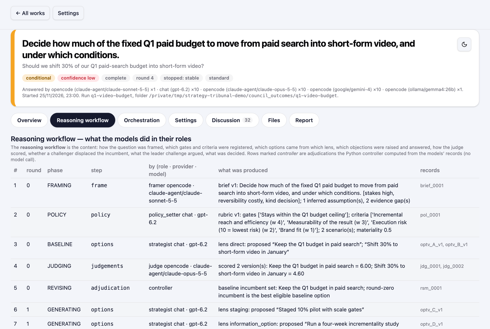
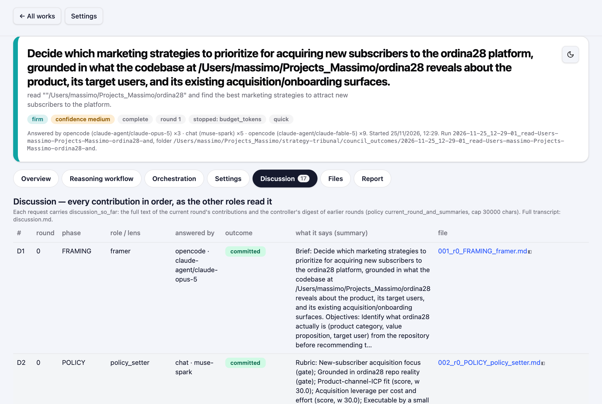
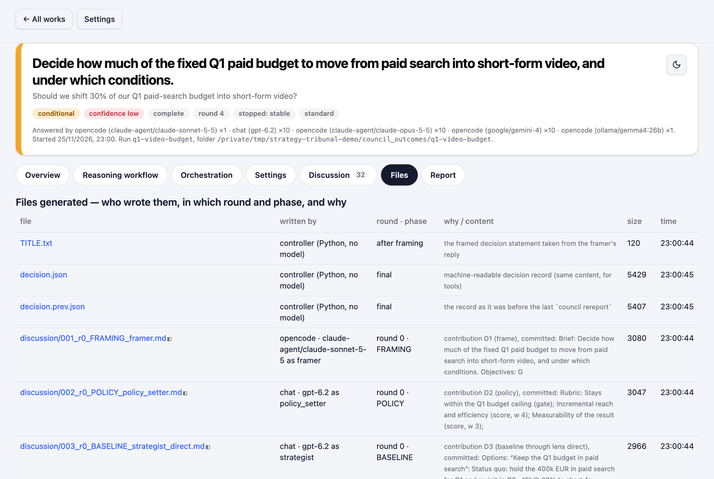
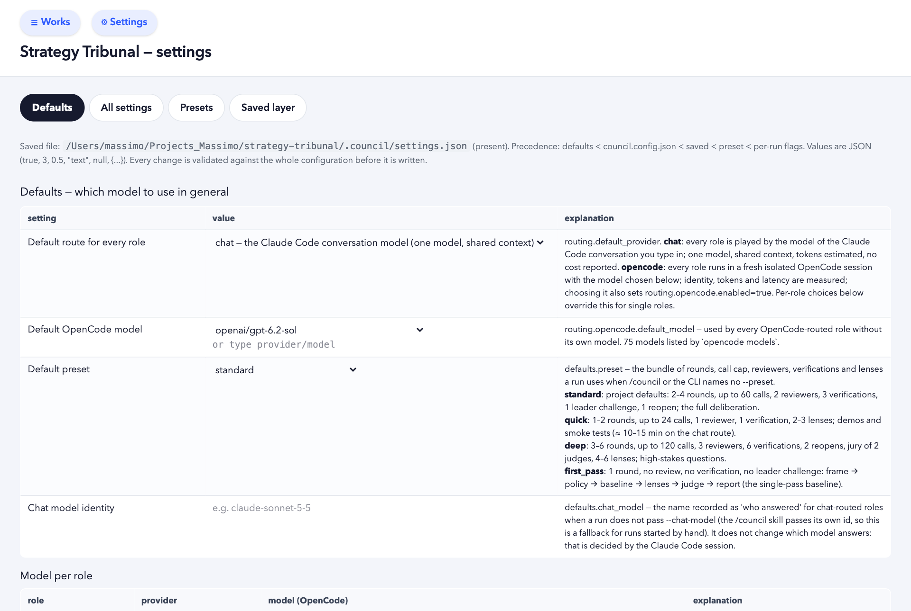

# Strategy Tribunal — user guide

Everything the README leaves out: how a session runs, the modes, installation in detail, every way to run it, the command line, the outputs, verification.

## How a session runs

You type a decision, topic or scope (for example *"Should we move 25 % of the Meta budget into TikTok Shop ads for Q1?"*). The engine then:

1. **Frames the decision** — objectives, stakeholders, hard constraints, time horizon, stakes, reversibility, evidence gaps, and the concrete decision a broad topic implies. User‑stated facts are kept verbatim; inferred assumptions are labelled.
2. **Registers an evaluation policy before ranking** — hard gates (pass / fail / unverified), 3–6 weighted score criteria with 0/5/10 anchors, priority scenarios, materiality threshold and promotion rule. A round‑zero baseline (status quo and the most direct answer) is scored first.
3. **Generates diverse strategies** through selectable reasoning *lenses* (first principles, inversion, staging, information option, asymmetric upside, outside view, execution, second order, expected value, time horizons, regret, tempo, internal/external, multidisciplinary, widen‑and‑reality‑test, balanced ledger, Six‑Hats observers). Duplicates are merged with lineage intact.
4. **Cross‑reviews and verifies** — typed challenges (target, failure mechanism, severity, class, what could change, resolution condition), compact rebuttals, optional verification calls, shared blind‑spot detection.
5. **Revises and adjudicates on matched inputs** — revisions, mergers, withdrawals and reinstatements are judged against the incumbent under the same brief, rubric, evidence snapshot and judge configuration. Promotion needs the challenger's conservative lower bound to clear the incumbent's upper bound; an evidence change forces a rescore; non‑comparable results are labelled, never imputed.
6. **Challenges the leader** — a dedicated sceptical pass must name the scenario in which the leader loses, the strongest alternative in that scenario and the evidence that would distinguish them. An unresolved challenge that could alter the outcome turns a firm recommendation into a conditional one.
7. **Stops for a recorded reason** — stability, no productive follow‑up, max rounds, call / token / time / cost budget, cancellation or failure — and **reports**: recommended action or reason to defer, strongest alternatives, decisive evidence, material dissent, trade‑offs, round‑by‑round change in decision quality, confidence with its basis, reversal conditions, one concrete next action, unfinished checks, and a machine‑readable decision record.

**Two workflows run in every council.** The **orchestration workflow** is the controller's state machine: it issues one validated request at a time to a role, checks the reply against the protocol, commits or rejects it, charges the budget, decides promotions and stops; it is deterministic Python and never reasons about the question. The **reasoning workflow** is what the models do in their roles: framing, gates and criteria, options through lenses, objections and answers, scores, the leader challenge, the decision. The dashboard and the report show both, step by step, with who produced each step (role, provider, model). Each role receives the records it needs as data (brief, policy, evidence snapshot, the options or challenge in question) **plus the discussion so far and the user's documents**; outputs of earlier phases reach later phases both as validated records and as the readable transcript.

**It is a discussion, not a loop of independent calls.** Every model contribution is written, in order, to `discussion/NNN_rR_<phase>_<role>.md` and `discussion.md` in the run folder, and every later request carries `discussion_so_far`: the full text of the current round's contributions plus the controller's digest of each earlier round (incumbent, outcome, ranking, open objections) and a short summary of every earlier contribution, within `discussion.max_chars`. Roles are instructed to build on, answer or contest what the others said and to list the D‑numbers they rely on in `builds_on`. On the chat route the model can also read the transcript files directly. Every request opens with a **context block** that explains the council, the role's place in it, who consumes the reply and whether the role has tools (see *What every model receives* below).

**Input documents.** `--docs path,folder` reads the user's files (text formats, size‑capped), copies them to `inputs/`, registers each as user‑supplied evidence (`ev_doc_<name>`) that every role can cite, and places capped excerpts in every request; on the chat route the full copies are readable. A local file or folder named in the question itself ("read /path/to/project and …") is registered the same way when no `--docs` is given.

Everything decision‑relevant (ids, versions, judgements, comparisons, events) is validated against a versioned protocol (`pydantic` v2) **before** state changes. Only the controller commits state; models only propose. Every run is persisted as an append‑only event log plus a snapshot, so it can be resumed, audited and re‑reported.

### Modes

| Mode | How | Context |
|---|---|---|
| **Default: one model in the current chat** | `/council …` inside Claude Code. The Python controller prints one validated request at a time; the chat model answers it in the named role (framer, policy setter, strategist, reviewer, verifier, judge, challenger); the controller validates, commits and advances. | Shared context (recorded as a limitation; no blind review is claimed) |
| **Opt‑in OpenCode route** | `--opencode` or `routing.opencode.enabled=true`; roles can be routed individually to other providers and models (Anthropic subscription, OpenAI, local Ollama, …) through a tools‑denied OpenCode agent. | Isolated: fresh session per call, pseudonymised review payloads, identity and measured tokens recorded |
| **Autonomous / headless** | `council run …` with a fixture (tests) or with all roles on OpenCode (benchmarks); or a headless Claude Code session `claude -p "/council …"`. | As above |

Every mode writes the run into its own folder under `council_outcomes/` and keeps a graphical dashboard (`index.html`) up to date; `council ui` serves all runs, KPIs and a settings editor on `127.0.0.1` (see **Web interface** below).

### Project layout

```
council/
├── .claude/skills/council/SKILL.md            chat entry point   /council …
├── .claude/skills/council-settings/SKILL.md   settings entry point   /council-settings …
├── council.config.json                        project defaults (configuration layer 2)
├── .council/settings.json                     saved settings (layer 3, written by `council settings …`)
├── council_outcomes/<YYYY-MM-DD_HH-MM-SS_question-slug>/   one folder per run: index.html (dashboard), TITLE.txt,
│                                              report.md, decision.json, state.json, events.jsonl, requests/, responses/
├── .council/runs/<run_id>/                    legacy run folders (still readable)
├── adapters/opencode/opencode.json            restricted OpenCode agent "council-member"
├── benchmarks/                                cases.json, run_campaign.py, results/
├── docs/                                      spec.md, llm_council.md (delivery record)
├── web/                                       the React interface (Vite + Tailwind 4 + Radix/shadcn-style components);
│                                              `npm run build` writes src/llm_council/static/dashboard.{js,css}
├── src/llm_council/                           ontology, config, settings, lenses, prompts, phases, judge, budget, discussion,
│                                              trail, state, engine, report, dashboard, ui, static/, providers/{fixture,opencode,driver}, cli
└── tests/                                     135 deterministic tests; fixtures built by tests/fixtures/build_fixtures.py
```

---

---

## Installation

Requirements: macOS or Linux, Python ≥ 3.12 with `pip` and `venv`, and for the chat mode [Claude Code](https://claude.com/claude-code). Optional: [OpenCode](https://opencode.ai) v2.x for the external route, with its own provider credentials (`opencode auth login`); the engine never reads, stores or logs credentials. Node.js is needed **only** to rebuild the web interface after editing `web/src` (`cd web && npm install && npm run build`); the built bundle ships in `src/llm_council/static/`, so using the interface needs no Node.

```bash
cd "/path/to/council"                     # this folder
python3 -m venv .venv                     # keep the venv at .venv: the Claude Code skills call .venv/bin/council
source .venv/bin/activate
pip install -e ".[dev]"                   # pydantic 2 + the `council` command (+ pytest)
council --version                         # council 0.1.0
python -m pytest                          # optional check: 135 passed, no model calls (use python -m: a Homebrew pytest may shadow the venv one)
```

Dependencies are declared in `pyproject.toml` (runtime: `pydantic>=2.7,<3`; dev: `pytest>=8`). Plain `pip` and `venv` are the only tools needed.

Start Claude Code **inside this folder**. The `/council` and `/council-settings` skills are discovered from `.claude/skills/` here and are not visible to a session started in a parent folder; they run `.venv/bin/council`, so the venv must exist at `.venv` in the project root.

Optional OpenCode route check:

```bash
opencode --version             # v2.x
opencode models                # providers/models OpenCode can reach
council config show --opencode
```

---

## Ten ways to run it

One protocol, three kinds of responder: the chat you are already in, models reached through OpenCode, or your own code. Any chat can play the responder: with tools it runs the commands itself, without tools you paste the request in and the reply back. "Verified" means exercised end to end in this repository; the rest follow the same four commands in `docs/responder.md`.

| # | Environment | Setup | Run | Status |
|---|---|---|---|---|
| 1 | **Claude Code** (terminal, desktop app, VS Code, JetBrains, web, headless) | install as above; start Claude Code inside this folder | `/council <question> --preset quick`; headless: `claude -p "/council <question>"` | verified |
| 2 | **Claude Desktop** (the chat app) | add the MCP server to `claude_desktop_config.json` (below); restart the app | ask: *"Run a council on: should we …?"* The app calls `council_start`, answers each request, calls `council_submit`, then shows the report | verified against the MCP stdio protocol; the app drives it as a tool server |
| 3 | **Claude on claude.ai** (no tools) | copy‑paste loop (below) | `council start --args "…" --chat-tools none` in zsh, paste the request into the chat, paste the reply back with `council submit <run> -` | verified |
| 4 | **ChatGPT** (no tools) | same copy‑paste loop; or route roles to OpenAI models through OpenCode (`openai/gpt-…`) | as 3; or `council run "…" --opencode` with `routing.opencode.default_model=openai/<model>` | copy‑paste verified; OpenCode route verified with OpenAI models |
| 5 | **Muse** (agent host, or Muse models) | as an agent host: give Muse `docs/responder.md`; as models: route roles to `muse-code/<model>` through OpenCode (the project's validation fallback is `muse-code/muse-spark-1.3-contributor`) | host: the agent runs the loop; models: `routing.roles.<role>.model=muse-code/<model>` | fallback route verified |
| 6 | **OpenCode** (agent host, or the multi‑model route) | host: start `opencode` in this folder with `docs/responder.md` as instructions; route: `opencode auth login`, then `council settings set routing.opencode.enabled=true routing.opencode.default_model=<provider/model>` | host: the agent runs the loop; route: `council run "<question>" --opencode --preset quick` with every role on OpenCode, or single roles via `routing.roles.<role>` | route verified (claude‑agent, OpenAI, Ollama, Muse models) |
| 7 | **zsh / any shell** | the venv | copy‑paste loop with any chat; `council run … --opencode` fully autonomous; `council ui` for the dashboards | verified |
| 8 | **Docker** | `docker build -t strategy-tribunal .` | `docker run --rm -p 127.0.0.1:8771:8771 -v "$PWD/work:/work" strategy-tribunal` serves the interface (bound off loopback inside the container, so it asks for a token on every request: printed at start, or set `COUNCIL_UI_TOKEN`; publish to loopback as shown); `docker run --rm -i -v "$PWD/work:/work" strategy-tribunal council start --args "…"` and `… council submit <run> - --request-id req_x < reply.json` drive a run | verified (image built, CLI and interface exercised in the container) |
| 9 | **Local models through Ollama** | `ollama pull <model>`; configure OpenCode's Ollama provider; `council settings set routing.opencode.default_model=ollama/<model>` | as 6, whole run or single roles | verified for the judge role |
| 10 | **Your own program** (Python, CI) | `pip install -e .` | `from llm_council.engine import Engine`; `council run --fixture tests/fixtures/main_run.json` replays a recorded deliberation with no model calls | verified (the test suite is this environment) |

Mixed routes are the normal case: the chat you are in plays most roles while the judge, a reviewer or the challenger runs on another vendor through OpenCode (`/council-settings routes`), so the second opinion comes from a model that did not write the options.

**Claude Desktop (MCP).** Add to `~/Library/Application Support/Claude/claude_desktop_config.json` (macOS) or `%APPDATA%\Claude\claude_desktop_config.json` (Windows), with your own paths:

```json
{
  "mcpServers": {
    "strategy-tribunal": {
      "command": "/path/to/strategy-tribunal/.venv/bin/council",
      "args": ["mcp", "--root", "/path/to/strategy-tribunal"]
    }
  }
}
```

Restart the app. The server announces seven tools (`council_start`, `council_submit`, `council_next`, `council_status`, `council_report`, `council_cancel`, `council_runs`) and its own instructions, so the chat knows the loop without a prompt from you. Runs land in the same `council_outcomes/` folder and the same dashboards.

**Copy‑paste loop (claude.ai, ChatGPT, any chat without tools).** In zsh:

```bash
council start --args "Should we …? --preset quick" --chat-tools none --chat-model "gpt-x"   # prints request 1
# paste the whole === COUNCIL REQUEST … === block into the chat; ask for exactly one JSON object
council submit <run_id> - --request-id req_0001 <<'EOF'
{ …the JSON the chat answered… }
EOF
# the next request is printed; repeat until === RUN COMPLETE ===
council report <run_id>
```

`--chat-tools none` tells every role it cannot read files, so the model declares what it would need instead of pretending; name your documents with `--docs` and the controller puts their content into the request. A fenced reply (```` ```json ````) is accepted as is.

---

---

## Giving the council context: files and folders

```bash
/council <question> --docs ./brief.md,./research,./data/q3.csv      # Claude Code
council start --args "<question> --docs ./brief.md,./research"      # any shell; the chat you use answers the requests
/council Read ./product-brief.md and decide which market we enter    # a path named in the question is registered too
```

- Every file is copied to `<run>/inputs/` and registered as user‑supplied evidence `ev_doc_<name>`; `inputs/INDEX.md` lists what was read and what was skipped and why.
- An excerpt of each document travels in **every** request (`documents` in the payload, capped by `documents.max_chars_in_payload`), so every role on every vendor sees the same material; hosts with file tools (Claude Code, OpenCode, Gemini CLI, Codex) are told to read the full copies; hosts without tools (web chats) are told they cannot.
- Text formats only (`documents.extensions`), folders recursively, hidden files skipped, `documents.max_file_bytes` per file and `documents.max_total_bytes` per run.
- Claims and challenges cite documents by evidence id, so the report shows which file backed which score.
- The run's own discussion is the second kind of context: `discussion_so_far` carries the current round in full and the controller's digest of earlier rounds to every later role.

## How to use it

### From Claude Code (recommended)

```
/council <question or topic> [--preset quick|standard|deep|first_pass] [--docs path,folder] [--opencode] [--lenses a,b,c] [--set key=value] [--run-id id]
/council-settings [show | set key=value … | unset key | wizard | routes | presets | reset]
```

The skill writes your arguments verbatim to an args file, starts the run, answers each `=== COUNCIL REQUEST … ===` block as the named role, submits, and finally shows the controller's summary, the full `report.md` and the `decision.json` path. Typical cost on the chat route: `quick` ≈ 24 model calls / 15 min, `standard` ≈ 45 calls / 15–20 min, `first_pass` ≈ 15–21 calls.

### From the command line

```bash
# step mode (what the skill does for you)
council start "<question>" [--preset …] [--opencode] [--lenses …] [--set k=v] [--run-id id]
council submit <run_id> <response.json> --request-id req_xxxx [--chat-model id] [--effort label]
council start "<question>" --chat-model claude-sonnet-5-5   # record which conversation model answers chat-routed requests
council next <run_id> [--set k=v]            # re-print the pending request / resume after an interruption
council status <run_id>                      # phase, round, incumbent changes, open objections, budget
council report <run_id> | rereport <run_id> | cancel <run_id> | runs
council dashboard <run_id> [--open]               # regenerate (and open) the run's index.html
council ui [--port 8771] [--no-open]                # local web interface: all runs, KPIs, dashboards, settings editor
council start "<question>" --ui                     # start a run and open its dashboard in the web interface

# autonomous mode (fixture or OpenCode providers)
council run "<question>" --fixture tests/fixtures/main_run.json --lenses staging,information_option,asymmetric_upside
council run "<question>" --preset quick --provider opencode --opencode

# configuration
council config show [--preset quick] [--opencode] [--set limits.max_rounds=3] [--run-id id]
council settings show|set|unset|reset|validate|routes|presets|wizard

# benchmarks
python benchmarks/run_campaign.py [--cases a,b] [--systems council_quick,first_pass] [--repeat N] [--out DIR]
python benchmarks/run_campaign.py --rescore benchmarks/results/<dir> [--reload-reports] [--reevaluate]
python benchmarks/run_campaign.py --merge <dirA>,<dirB> --out benchmarks/results/<dir>
```

### Reading the result

The decision is the **Recommended action** at the top of `report.md` (or the Outcome section of the dashboard's Report tab), restated plainly in the **In plain words** box: what was decided, what to do next, why it won with the scores, the honest caveats, and the clearest tripwire that would flip it. Every report is at least 600 words; short runs gain an appendix with the full option texts so the report stands alone. Any Markdown file in the interface — report, discussion, contributions, input copies — opens fully formatted in a modal window. Rebuild the report, decision record and dashboard from the saved state at any time without spending model calls: `council rereport <run_id>` and `council dashboard <run_id>` (the served UI picks up code changes only after a server restart).

### What every model receives (prompt contract)

Every request carries, in this order: a **context block** (how the council works — the fixed phase sequence —, where this request sits: phase, round of max rounds, lens; who consumes the reply and what it changes; the terms gate/score/incumbent/materiality and the id prefixes, including the `OPT-n` pseudonyms; whether the role has tools — Claude Code roles are told to read any named path and the run folder, OpenCode roles are told they have none and must flag what would need reading; today's date; the useful size of the answer), the **role instructions**, the **lens method**, the **discussion** and **documents** notes, and the **guardrails** (language of the question, no D-numbers inside text fields, id rules). The payload adds `capabilities` (`tools`, `can_read_files`, `today`), `valid_target_ids` for reviewers (option versions, claims and assumptions a challenge may target; an assumption targets the option holding it), and, on a retry, `previous_reply` with `previous_attempt_error` and a *repair* instruction (fix only the error). The JSON schema documents every field (`description`) and every reply may list the D-numbers it relies on in `builds_on`.

Rejections are rarer and cheaper: the controller first repairs the JSON slips models make (trailing commas, a string wrapped in parentheses, typographic quotes, comments), then validates; a review whose challenges are partly invalid is **committed in part** (the valid challenges are opened, the invalid targets, unknown evidence ids and unknown dissent refs are dropped and listed in the discussion entry and in the `response_committed` event as `partial`); only a reply with nothing valid is rejected. Reviewers and judges on isolated routes get the discussion **blind** (no participant ids, providers or models); judges never see the ranking numbers and get summaries only; roles whose payload already carries the options get those contributions as summaries marked `see_payload`. When the question names a local file or folder and no `--docs` is given, the controller registers it as documents automatically (`inputs/INDEX.md` says so), so tool-less roles see its content too.

### Follow-up prompt

Once a run has a decision, `report.md` ends with a **Follow-up prompt** and the run page shows it under the Overview and the Report tab with a **Copy prompt** button (clicking the text copies it too): the question, the decision and why, the next action, reversal conditions, open objections, unfinished checks, influential assumptions, the run folder, and the ask (plan the next action step by step, owners, metrics, cheapest tests for what is open, first thing to do tomorrow, disagree with the council if warranted). Paste it into Claude Code to continue from the report.

### Presets

| Preset | Rounds | Call cap | Review | Notes |
|---|---|---|---|---|
| `quick` | 1–2 | 24 | 1 reviewer, 1 verification | demos and smoke tests |
| `standard` (default) | 2–4 | 60 | 2 reviewers, 3 verifications | full deliberation with reopen |
| `deep` | 3–6 | 120 | 3 reviewers, 6 verifications, jury of 2 | high‑stakes questions |
| `first_pass` | 1 | project cap | none | llm‑council‑style single pass: frame → policy → generate → judge → report |

### Configuration precedence

built‑in defaults < `council.config.json` (project) < `.council/settings.json` (saved, via `council settings` or `/council-settings`) < `--preset` < per‑run flags (`--set key=value`, `--opencode`, `--provider`, `--lenses`, `--fixture`).

`council config show` prints every effective key with the layer it came from (`<- defaults | project | saved | preset:<name> | override`), the enabled external routes, per‑role routing, and how each limit is enforced (calls counted; elapsed measured; tokens measured on OpenCode replies and estimated on chat replies; cost only when a provider reports it).

### Settings commands

| Command | What it does |
|---|---|
| `council settings show [--section limits]` | saved file (or "absent"), layers present, every effective key with its layer, external routes, per‑role routing, limit enforcement |
| `council settings set k=v …` | validate the **whole effective configuration** with the new values, then write them to `.council/settings.json`; an invalid value prints `error: … nothing written` (exit 2) |
| `council settings unset k …` | remove saved keys (the project or default value applies again) |
| `council settings reset --yes` | delete the saved file |
| `council settings validate [file.json]` | VALID / INVALID for the saved file or a candidate file |
| `council settings routes` | provider, model and sampling per role; OpenCode state and fallback |
| `council settings presets` | the four presets and what they change |
| `council settings wizard [--answer k=v …]` | every key with its question, current value and default; answers are applied like `set` |

Values are JSON: `true`, `3`, `0.5`, `"claude-agent/haiku"`, `null`, `{"a":1}`, `["x","y"]`. Quote JSON objects and strings for the shell: `'policy.weight_overrides={"cost":5}'`. The same keys work per run with `--set`, e.g. `/council <question> --set limits.max_rounds=3`.

---

### Outputs: one folder per council work

Each run lives in `council_outcomes/<YYYY-MM-DD_HH-MM-SS_first-words-of-the-question>/` under the project root (the folder Claude Code was started in); the run id **is** the folder name; it contains no spaces, so it needs no quoting in commands and no percent-encoding in URLs. `storage.runs_root` changes the location; older runs under `.council/runs/` stay readable.

- `discussion.md` and `discussion/NNN_rR_<phase>_<role>.md` — every model contribution in order, rendered as text with its raw JSON (what the other roles read);
- `inputs/` — copies of the user's documents and `INDEX.md` (what was read, what was skipped and why);
- `index.html` — the graphical dashboard (below), rewritten after every controller step;
- `TITLE.txt` — the framed decision statement, written as soon as the framer has answered;
- `report.md` — the human report. It opens with an **In plain words** verdict (the decision, what to do next, why it won with the scores, the honest caveats, the clearest tripwire) and is always at least 600 words — short runs gain an appendix with the full option texts so the report stands alone. Then: outcome, recommended action, alternatives, decisive evidence, dissent and open objections, trade‑offs, round‑by‑round table, signals, reversal conditions, what the council failed to establish, unfinished checks, lineage, budget, limitations;
- `decision.json` — the machine‑readable decision record;
- `state.json`, `events.jsonl` — full auditable state and append‑only event log;
- `requests/`, `responses/` — every request issued and every raw reply (validation errors and retries are in the event log).

### Web interface

How to start the server, the URL table and the works, verdict and follow-up screenshots are in the README, [The interface](../README.md#the-interface). The other pages:

#### Reasoning workflow: what the models did

<p align="center"></p>

One row per step of the deliberation: the brief, the rubric with its gates and weights, the options per lens, the objections, the verifications, the responses, the scores, the controller's adjudications, the leader challenge, the decision. Every row names the role, the provider and the model that produced it and the record ids it created. The **Orchestration** tab is the other workflow: every controller request in order with tokens, latency and result, plus who answered per participant and the request/response log.

#### Discussion: what every role read

<p align="center"></p>

The transcript as the later roles received it: D‑numbers in order, round, phase, role and lens, who answered, committed or rejected, the summary, and the full Markdown one click away in a dialog. The input documents the council read are listed with their evidence ids.

#### Files: who wrote what, and why

<p align="center"></p>

Every file in the run folder with its author (the controller or a model with its provider), the round and phase it belongs to, what it is for, size and time. Markdown opens formatted in place.

#### Settings

<p align="center"></p>

Defaults first: the route every role takes (chat or OpenCode), the default OpenCode model picked from what `opencode models` returns, the preset, the chat model identity, and a provider and model per role. Below, every key with its value, the layer it came from (default, project, saved, preset), its explanation and its allowed values; a form sets, unsets or resets any of them. Every write is validated against the whole configuration before it lands in `.council/settings.json`, and keys that name executables or paths are terminal‑only.

---

---

## Verification

```bash
python -m pytest   # 135 deterministic tests: protocol validation, state machine, judge arithmetic, promotion/regression,
                     # matched rescoring, budgets, cancellation/resume, OpenCode route, validation fallbacks (fake binary),
                     # settings, rubric weights, reframe/reinstate/tiebreak/jury fixtures, benchmark checkers,
                     # discussion transcript and documents, dashboard/UI state and server, prompt contract
                     # (context block, valid targets, partial review commits, JSON repair, blind discussion,
                     # auto-detected documents, follow-up prompt)
cd web && npm run build   # only after editing web/src: rebuilds src/llm_council/static/dashboard.{js,css}
```

Live verification, OpenCode route, benchmark outcomes and known open items are recorded in `docs/llm_council.md` §16.

## Licence notes

The six reference projects under `original/` are read‑only inspiration; no code or prompt text was copied. See `docs/llm_council.md` §15.